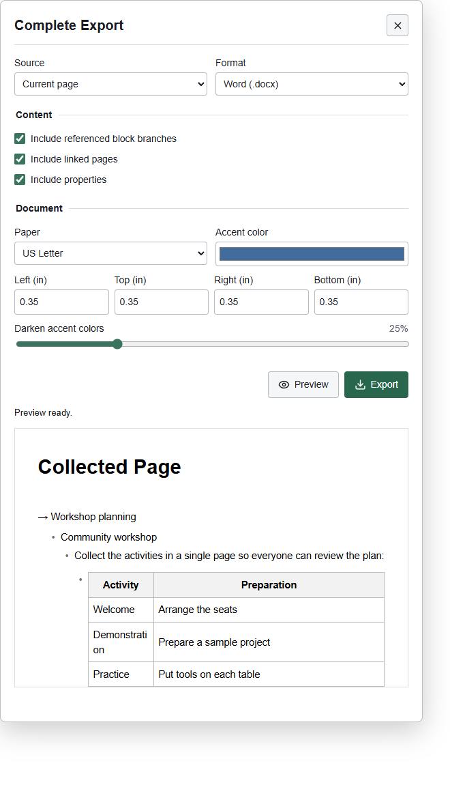

# Complete Export for Logseq DB

Export Logseq DB content to **Word (DOCX), PDF, interactive HTML, Markdown, or JSON**. Targets Logseq DB Desktop 2.0.1.

## What You Can Export

| Source | Included content |
| --- | --- |
| Block | The selected block, including embedded content within it |
| Branch | The selected block and its children, including collapsed children |
| Page | The current page or a page selected by name |
| Collected page | A page containing embedded branches/pages, block or page references, and supported query results |
| Entire graph | Visible pages, classes, and journals; a content export, not a database backup |

Linked-reference and unlinked-reference panels are not included. References, embeds, and queries within the selected content are included according to the export options.

## How to Use

1. **Block or branch:** right-click a block's bullet and choose **Complete Export: block** or **Complete Export: branch**.
2. **Page:** open the page menu and choose **Complete Export: page**. You can also click the toolbar's download icon or run **Complete Export: export content** from the command palette.
3. Choose the **Source** and **Format**. For another page, select **Named page** and enter its name. For a graph export, select **Entire graph**.
4. Adjust content options, paper size, margins, and accent colors as needed.
5. Click **Preview** to review the resolved content, then **Export** to download the selected format. DOCX and PDF paginate according to the selected paper size.

Explicit page/block embeds and referenced block branches resolve recursively, including collapsed children. Whole-page embeds include the embedded page's contents. Ordinary page links and tags stay inline and do not expand other pages. Circular-reference warnings appear in the plugin's notices and companion report, not the exported document body. Missing references remain visible so missing content is not silently hidden.

## Query Support

DB query definitions are read directly from `:logseq.property/query` nodes, which can be omitted by the regular block API. Simple queries run through Logseq's DSL API. Advanced queries run through its Datascript API with inputs, custom rules, and the built-in rule definitions from 2.0.1. A bundled SCI ClojureScript interpreter applies common result transforms and custom Hiccup views. Query execution failures stop the export instead of silently omitting sections. Exports are snapshots; queries do not remain live outside Logseq.

## Features

Settings persist across sessions. Default document margins are 0.35 inches on each side. Main text is black and background is white, independent of the theme. Accent colors can be selected and darkened. Explicit inline span colors are retained, including colors with alpha (composited against white); CSS color variables are resolved through the SDK when available. A bundled, read-only host helper converts theme-defined span classes to explicit text colors for preview, DOCX, PDF and HTML, including when the plugin iframe cannot access the host document. It uses Logseq's experimental script-loading API and sends only requested class names and resolved colors between the plugin and host; no network service is involved. Inherited theme colors and source background/layout styles are not copied.

## Format Behavior

Outline indentation continues through embedded branches instead of flattening deeper levels. Exceptionally deep outlines use a smaller uniform indentation step to fit the page. Table columns share space according to their headers and contents, so short ID/status columns are narrower than long-text columns. These proportions are calculated for export rather than copying exact pixel widths from Logseq.

Pinned containers (`#+BEGIN_PINNED` / `#+END_PINNED`) render with a pin icon and separator in preview, DOCX, PDF and HTML; Markdown uses a pin symbol. Table cells may contain ` ` and balanced multiline `
` elements. Theme-defined `<mark>` backgrounds are sampled alongside span colors and retained as text highlights in preview, DOCX, PDF and HTML. JSON keeps the resolved source text rather than converting its markup.

The export panel's **Integration details** show plugin version, embed child counts, and color-helper status without note text, page names, UUIDs or class names. These details stay in the panel and are not added to exported documents.

| Format | Preserved behavior |
| --- | --- |
| DOCX | Editable text, basic Markdown formatting, tables, images, links, bookmarks and Word outline levels; no live Logseq queries |
| PDF | Selectable text, basic formatting, tables, embedded images, internal/external links and expanded outlines; static document |
| HTML | Self-contained embedded images, nested expand/collapse, internal navigation, external and Logseq links |
| Markdown | Text, nested outlines, Markdown syntax and Logseq links; DB image elements embed their image data and caption, with HTML image support depending on the Markdown reader |
| JSON | Resolved tree, UUIDs, properties, collapse state, options and notices; a portable snapshot, not a native Logseq backup |

Logseq links open the source graph when the application is installed. HTML and DOCX links point within the exported content when the destination is present. Graph export includes pages/classes/journals returned by the SDK, excluding hidden/property pages; it is a content export rather than a database backup.

Only the selected content is collected, including embeds and query sections within it. The separate linked-reference and unlinked-reference panels are not exported. Image sizing uses the visible host image width or saved resize metadata when available; otherwise DB image thumbnails default to at most 250 pixels. DOCX and PDF paginate normally when expanded content exceeds the selected paper size.

## Install

### Logseq Marketplace

1. In Logseq DB Desktop, open **Plugins** from the main menu.
2. Select **Marketplace** and search for **Complete Export**.
3. Click **Install** on the plugin's listing.

Marketplace installation handles downloading and installing the plugin; there is no need to extract a ZIP or load an unpacked folder.

For an existing installation, open **Plugins > Installed** and use **Check update** or **Update** on Complete Export. If the latest release has not appeared in the marketplace yet, use the manual option below.

### Manual Installation (Fallback or for Testing)

1. Download the plugin ZIP attached to the [latest release](https://github.com/bgrimes-git/logseq-complete-export/releases/latest), not GitHub's source-code archive, and extract it into a dedicated folder.
2. Enable developer mode in Logseq DB's settings.
3. Open **Plugins**, choose **Load unpacked plugin**, and select the extracted folder containing `package.json`.

### Build From Source (Developers)

Run `npm ci` and `npm run build` in a source checkout, then load the checkout folder using **Load unpacked plugin**. Do not select the `dist` subfolder.

## Current limits

PDFs use PDF 1.4 for transparency compatibility and are checked for parseable structure, finite page/annotation dimensions, and resolvable internal destinations before download. These checks do not establish the cause of a crash in a particular workstation's PDF preview handler.

DOCX packages are checked for well-formed XML, valid bookmarks, internal links, and package relationships before download. Unsupported control characters are removed consistently across formats, with a notice. Windows device names and filename control characters are neutralized. Images over 16 MiB, 16 million pixels, or 16,384 pixels on either side are not embedded; a notice identifies the omission. Embedded images are limited to 64 MiB per document conversion and downloads to 128 MiB. These checks reduce malformed-file and resource risks, but cannot guarantee that every third-party preview handler will behave correctly.

Custom renderer macros, whiteboard canvases, and arbitrary plugin widgets are not evaluated. Advanced query functions that depend on private frontend namespaces or unavailable libraries need compatibility work; failures are explicit. Standard Markdown tables and images are supported; image fetch failures produce notices. DB structured properties retain their SDK representation, including IDs where the SDK supplies IDs. Theme accent sampling depends on host DOM access; the color picker supplies a reliable fallback. PDF uses bundled Roboto; scripts outside that font's coverage require additional font support. Expanded documents are limited to 50,000 blocks and 80 levels to prevent runaway graphs. Page references may expand the graph substantially.

Build and resolver/export/query tests can be run outside Logseq (`npm run build`, `npm test`). `npm run test:browser` builds and checks all five download formats against a simulated DB graph, plus desktop/mobile screenshots, using installed Microsoft Edge. The installed Logseq DB version still needs a real-graph integration check, especially for DB embed/alias serialization and your query definitions. No graph content is changed by this plugin, and no export content is sent to a service. Remote images are fetched only to embed them in the output.

The plugin is AGPL-3.0-only because it includes Logseq's 2.0.1 query rules. See `THIRD_PARTY.md` for attribution.

## Preview

